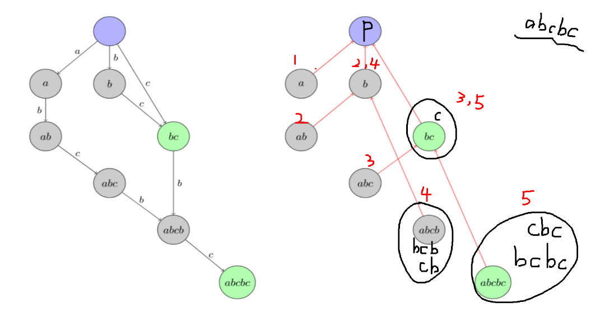
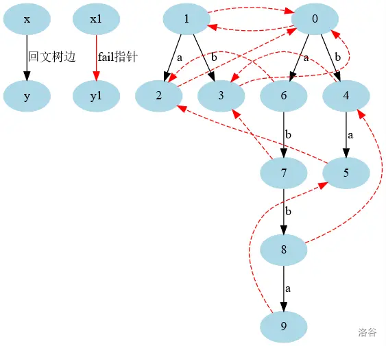

# 字符串
## SA
```cpp
// 1-based
struct SA {
    int m = 127;
    int n;
    vector<int> sa, rk, height;
    SA(const string &s) {
        n = s.size() - 1;
        sa.resize(n + 1);
        rk.resize(n + 1);
        height.resize(n + 1);
        vector<int> cnt(m + 1);
        for (int i = 1; i <= n; i++) {
            cnt[rk[i] = s[i]]++;
        }
        for (int i = 1; i <= m; i++) {
            cnt[i] += cnt[i - 1];
        }
        for (int i = n; i >= 1; i--) {
            sa[cnt[rk[i]]--] = i;
        }
        vector<int> id(n + 1), oldrk;
        for (int w = 1, p; ; w <<= 1, m = p) {
            int cur = 0;
            for (int i = n - w + 1; i <= n; i++) {
                id[++cur] = i;
            }
            for (int i = 1; i <= n; i++) {
                if (sa[i] > w) {
                    id[++cur] = sa[i] - w;
                }
            }
            cnt.assign(m + 1, 0);
            for (int i = 1; i <= n; i++) {
                cnt[rk[i]]++;
            }
            for (int i = 1; i <= m; i++) {
                cnt[i] += cnt[i - 1];
            }
            for (int i = n; i >= 1; i--) {
                sa[cnt[rk[id[i]]]--] = id[i];
            }
            oldrk = rk;
            p = 0;
            for (int i = 1; i <= n; i++) {
                if (oldrk[sa[i]] == oldrk[sa[i - 1]] && 
                    oldrk[sa[i] + w] == oldrk[sa[i - 1] + w]) {
                    rk[sa[i]] = p;
                } else {
                    rk[sa[i]] = ++p;
                }
            }
            if (p == n) break;
        }
        for (int i = 1, j = 0; i <= n; i++) {
            if (rk[i] == 1) continue;
            if (j) j--;
            while (s[i + j] == s[sa[rk[i] - 1] + j]) {
                j++;
            }
            height[rk[i]] = j;
        }
    }
};

// 应用
int L = 2 * n, K = 20;
vector st(L + 1, vector<int>(K));
for (int i = 1; i <= L; i++) {
    st[i][0] = sa.height[i];
}
for (int j = 1; j < K; j++) {
    for (int i = 1; i + (1 << j) - 1 <= L; i++) {
        st[i][j] = min(st[i][j - 1], st[i + (1 << j - 1)][j - 1]);
    }
}
auto rmq = [&](int l, int r) {
    int k = __lg(r - l + 1);
    return min(st[l][k], st[r - (1 << k) + 1][k]);
};
auto lcp = [&](int i, int j) {
    if (i == j) {
        return n - i + 1;
    }
    int a = sa.rk[i];
    int b = sa.rk[j];
    if (a > b) {
        swap(a, b);
    }
    return rmq(a + 1, b);
};
auto lcs = [&](int i, int j) {
    if (i == j) {
        return i;
    }
    int a = sa.rk[2 * n + 1 - i];
    int b = sa.rk[2 * n + 1 - j];
    if (a > b) {
        swap(a, b);
    }
    return rmq(a + 1, b);
};

```
## SAIS
```cpp
struct SA {
    vector<int> sa, rk, height;
    SA(const string &init) {
        int n = init.size() - 1;
        vector<int> s;
        for (int i = 1; i <= n; i++) {
            s.push_back(init[i]);
        }
        s.push_back(0);

        sa = SAIS(s, 128);
        rk.assign(n + 1, 0);
        height.assign(n + 1, 0);
        for (int i = 1; i <= n; i++) {
            sa[i]++;
            rk[sa[i]] = i;
        }
        for (int i = 1, j = 0; i <= n; i++) {
            if (rk[i] == 1) continue;
            if (j) j--;
            while (init[i + j] == init[sa[rk[i] - 1] + j]) {
                j++;
            }
            height[rk[i]] = j;
        }
    }
    bool is_LMS_char(const vector<bool> &type, int x) {
        return x >= 1 && type[x] == 1 && type[x - 1] == 0;
    }
    bool is_LMS_equal(const vector<int> &s, vector<bool> &type, int x, int y) {
        do {
            if (s[x] != s[y]) {
                return false;
            }
            x++, y++;
        } while (!is_LMS_char(type, x) && !is_LMS_char(type, y));
        return s[x] == s[y];
    }
    void inducedSort(const vector<int> &s, vector<int> &sa, vector<bool> &type, 
                    vector<int> &bucket, vector<int> &L_bucket, vector<int> &S_bucket, 
                    int ALPHABET_SIZE) {
        int n = s.size() - 1;
        for (int i = 0; i <= n; i++) {
            if (sa[i] > 0) {
                int p = sa[i] - 1;
                if (type[p] == 0) {
                    int ch = s[p];
                    sa[L_bucket[ch]++] = p;
                }
            }
        }
        for (int i = 1; i < ALPHABET_SIZE; i++) {
            S_bucket[i] = bucket[i] - 1;
        }
        for (int i = n; i >= 0; i--) {
            if (sa[i] > 0) {
                int p = sa[i] - 1;
                if (type[p] == 1) {
                    int ch = s[p];
                    sa[S_bucket[ch]--] = p;
                }
            }
        }
    }
    vector<int> SAIS(const vector<int> &s, int ALPHABET_SIZE) {
        int n = s.size() - 1;
        vector<int> bucket(ALPHABET_SIZE, 0);
        vector<int> L_bucket(ALPHABET_SIZE, 0);
        vector<int> S_bucket(ALPHABET_SIZE, 0);
        for (int i = 0; i <= n; i++) {
            bucket[s[i]]++;
        }
        for (int i = 1; i < ALPHABET_SIZE; i++) {
            bucket[i] += bucket[i - 1];
            L_bucket[i] = bucket[i - 1];
            S_bucket[i] = bucket[i] - 1;
        }
        vector<bool> type(n + 1);
        type[n] = 1;  // 终止符是S型 (L: 0, S: 1)
        for (int i = n - 1; i >= 0; i--) {
            if (s[i] < s[i + 1]) {
                type[i] = 1;
            } else if (s[i] > s[i + 1]) {
                type[i] = 0;
            } else {
                type[i] = type[i + 1];
            }
        }
        vector<int> LMS;
        for (int i = 1; i <= n; i++) {
            if (type[i] == 1 && type[i - 1] == 0) {
                LMS.push_back(i);
            }
        }
        int cnt = LMS.size();
        
        vector<int> sa(n + 1, -1);
        for (int i = 0; i < cnt; i++) {
            int ch = s[LMS[i]];
            sa[S_bucket[ch]--] = LMS[i];
        }
        inducedSort(s, sa, type, bucket, L_bucket, S_bucket, ALPHABET_SIZE);
        
        vector<int> name(n + 1, -1);
        int name_cnt = 1, lst = -1;
        bool flag = false;
        for (int i = 1; i <= n; i++) {
            int p = sa[i];
            if (is_LMS_char(type, p)) {
                if (lst >= 0 && !is_LMS_equal(s, type, p, lst)) {
                    name_cnt++;
                }
                if (lst >= 0 && name_cnt == name[lst]) {
                    flag = true;
                }
                name[p] = name_cnt;
                lst = p;
            }
        }
        name[n] = 0;

        vector<int> s1(cnt);
        int pos = 0;
        for (int i = 0; i <= n; i++) {
            if (name[i] >= 0) {
                s1[pos++] = name[i];
            }
        }

        vector<int> sa1;
        if (!flag) {
            sa1.assign(cnt + 1, 0);
            for (int i = 0; i < cnt; i++) {
                sa1[s1[i]] = i;
            }
        } else {
            sa1 = SAIS(s1, name_cnt + 1);
        }
        L_bucket[0] = S_bucket[0] = 0;
        for (int i = 1; i < ALPHABET_SIZE; i++) {
            L_bucket[i] = bucket[i - 1];
            S_bucket[i] = bucket[i] - 1;
        }
        fill(sa.begin(), sa.end(), -1);
        for (int i = cnt - 1; i >= 0; i--) {
            int pos = LMS[sa1[i]];
            int ch = s[pos];
            sa[S_bucket[ch]--] = pos;
        }
        inducedSort(s, sa, type, bucket, L_bucket, S_bucket, ALPHABET_SIZE);
        return sa;
    }
};
```

## SAM
```cpp
struct SAM {
    static constexpr int ALPHABET_SIZE = 26;
    struct Node {
        int len = 0;
        int link = 0;
        array<int, ALPHABET_SIZE> ch;
        int endpos = -1;
    };
    int last;
    vector<Node> t;
    SAM() {
        init();
    }
    void init() {
        last = 1;
        t.assign(2, Node());
    }
    int newNode() {
        t.emplace_back();
        return t.size() - 1;
    }
    void extend(int c, int id) {
        int p = last, cur = newNode();
        t[cur].len = t[p].len + 1;
        for (; p && !t[p].ch[c]; p = t[p].link) {
            t[p].ch[c] = cur;
        }
        if (!p) {
            t[cur].link = 1;
        } else {
            int q = t[p].ch[c];
            if (t[q].len == t[p].len + 1) {
                t[cur].link = q;
            } else {
                int r = newNode();
                t[r].len = t[p].len + 1;
                t[r].link = t[q].link;
                t[r].ch = t[q].ch;
                t[cur].link = t[q].link = r;
                for (; p && t[p].ch[c] == q; p = t[p].link) {
                    t[p].ch[c] = r;
                }
            }
        }
        last = cur;
        t[cur].endpos = id;
    }
    Node& operator[](const int &id) {
        return t[id];
    }
};
```


## ACAM
```cpp
struct ACAM {
    static constexpr int ALPHABET_SIZE = 26;
    struct Node {
        int fail;
        array<int, ALPHABET_SIZE> ch;
        int len, cnt;
        Node() : fail{}, ch{}, len{}, cnt{} {}
    };
    int tot;
    vector<Node> t;
    ACAM() {
        init();
    }
    void init() {
        tot = 1;
        t.assign(1, Node());
    }
    int newNode() {
        tot++;
        t.emplace_back();
        return tot - 1;
    }
    void insert(string s) {
        int p = 0;
        for (int i = 0; i < s.size(); i++) {
            int c = s[i] - 'a';
            if (!t[p].ch[c]) {
                t[p].ch[c] = newNode();
            }
            p = t[p].ch[c];
        }
        t[p].len = s.size();
        t[p].cnt++;
    }
    void build() {
        queue<int> q;
        for (int c = 0; c < ALPHABET_SIZE; c++) {
            if (t[0].ch[c]) {
                q.push(t[0].ch[c]);
            }
        }
        while (!q.empty()) {
            auto u = q.front();
            q.pop();
            for (int c = 0; c < ALPHABET_SIZE; c++) {
                if (t[u].ch[c]) {
                    t[t[u].ch[c]].fail = t[t[u].fail].ch[c];
                    q.push(t[u].ch[c]);
                } else {
                    t[u].ch[c] = t[t[u].fail].ch[c];
                }
            }
        }
    }
    Node& operator[](const int &id) {
        return t[id];
    }
};
```

## PAM
```cpp
struct PAM {
    constexpr static int ALPHABET_SIZE = 26;
    struct Node {
        int len;
        int link;
        array<int, ALPHABET_SIZE> ch;
    };
    vector<Node> t;
    PAM() {
        init();
    }
    void init() {
        t.assign(2, Node());
        t[1].len = -1;
        t[1].link = -1;
        t[0].link = 1;
    }
    int newNode() {
        t.emplace_back();
        return t.size() - 1;
    }
    int extend(const string &s, int p, int i) {
        while (i - t[p].len - 1 < 0 || s[i - t[p].len - 1] != s[i]) {
            p = t[p].link;
        }
        int c = s[i] - 'a';
        if (!t[p].ch[c]) {
            int cur = newNode();
            t[cur].len = t[p].len + 2;
            t[p].ch[c] = cur;
            if (p == 1) {
                t[cur].link = 0;
            } else {
                p = t[p].link;
                while (i - t[p].len - 1 < 0 || s[i - t[p].len - 1] != s[i]) {
                    p = t[p].link;
                }
                t[cur].link = t[p].ch[c];
            }
            return cur;
        }
        return t[p].ch[c];
    }
    Node &operator[](const int &id) {
        return t[id];
    }
};
void solve() {
    string s;
    cin >> s;
    int n = s.size();

    vector<int> cnt(n + 2);
    PAM pam;

    int p = 0;
    for (int i = 0; i < n; i++) {
        p = pam.extend(s, p, i);
        cnt[p] = cnt[pam[p].link] + 1;
        cout << cnt[p] << " "; // 以 i 结尾回文子串个数
    }
}
```


## Hash
```cpp
constexpr int P = 131, mod1 = 998244353, mod2 = 1e9 + 7;
struct Hash {
    vector<int> p1, h1;
    vector<int> p2, h2;
    Hash() {}
    Hash(string s) {
        init(s);
    }
    void init(string s) {
        int n = s.size();
        p1.assign(n, 1);
        h1.assign(n, 0);
        // p2.assign(n, 1);
        // h2.assign(n, 0);

        for (int i = 1; i < n; i++) {
            p1[i] = p1[i - 1] * P % mod1;
            h1[i] = (h1[i - 1] * P % mod1 + s[i]) % mod1;

            // p2[i] = p2[i - 1] * P % mod2;
            // h2[i] = (h2[i - 1] * P % mod2 + s[i]) % mod2;
        }
    }
    int substr_hash1(int l, int r) {
        int hash1 = ((h1[r] - h1[l - 1] * p1[r - l + 1] % mod1) % mod1 + mod1) % mod1;
        return hash1;
    }
    int substr_hash2(int l, int r) {
        int hash2 = ((h2[r] - h2[l - 1] * p2[r - l + 1] % mod2) % mod2 + mod2) % mod2;
        return hash2;
    }
};
```